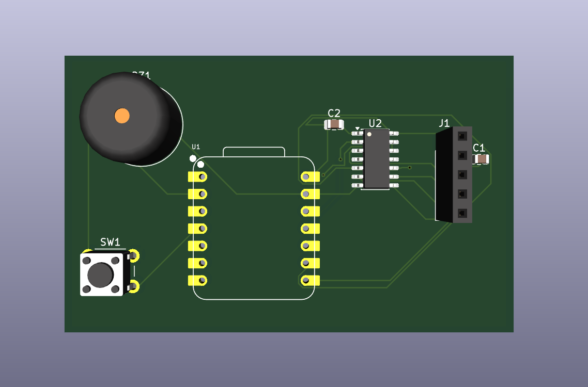
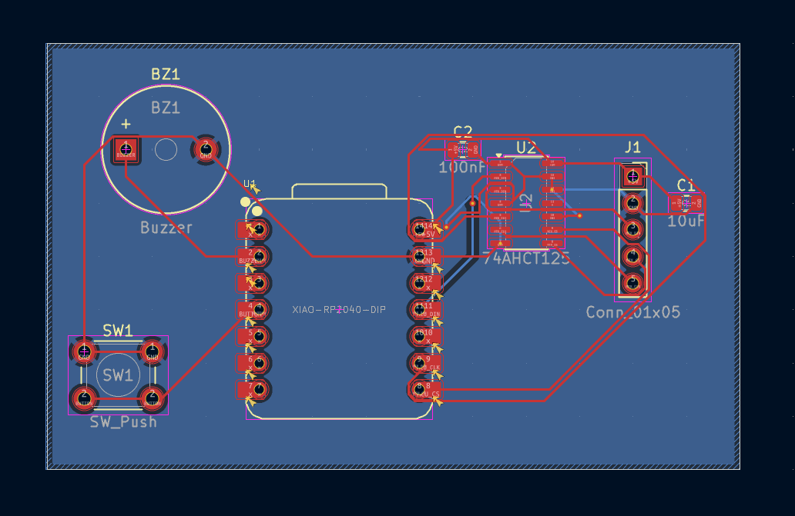
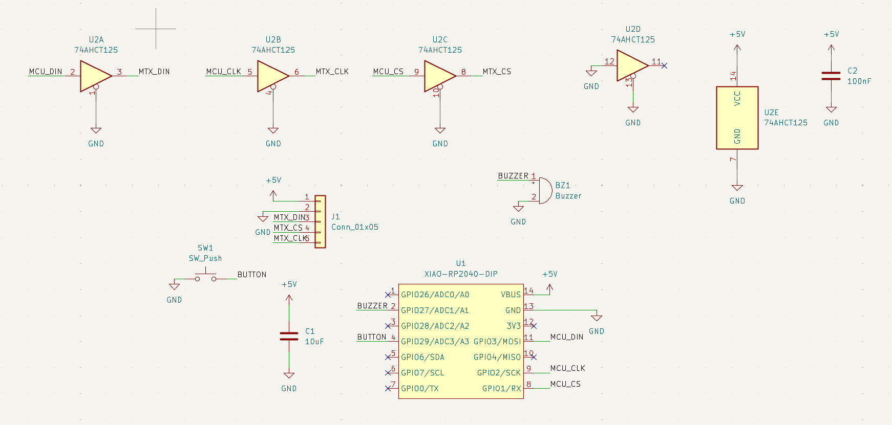

## EyeDoro!

Eyedoro is a desk buddy with two robot eyes that works as a Pomodoro study timer.
Press the button to start a 25 minute work session. While you work, the eyes look
around as if they are watching over you. When time is up, a beep plays and the eyes
fall asleep for a 5 minute break, then a lower beep wakes them up.

I made it because [your reason in your own words, 1 or 2 lines].

A Seeed XIAO RP2040 drives two 8x8 MAX7219 LED matrix modules (the eyes) over SPI.
A 74AHCT125 level shifter turns the XIAO's 3.3 V signals into the 5 V signals the
MAX7219 needs. A button starts and pauses the timer and a passive buzzer plays the alerts.

## Features
- Two LED matrix eyes that glance around while you work
- 25 minute work and 5 minute break timer
- Eyes fall asleep during the break and wake up when it ends
- Start and pause button
- Buzzer with a different tune for work done and break done
- Level shifter so the 3.3 V XIAO can safely drive the 5 V MAX7219

## PCB

## Schematic

## Bill of materials
- 1x Seeed XIAO RP2040
- 2x single 8x8 MAX7219 module
- 1x 74AHCT125 (SOIC-14)
- 1x 10 uF capacitor (0805)
- 1x 100 nF capacitor (0805)
- 1x push button (6 mm)
- 1x passive buzzer
- 1x 5-pin female header (J1)

## Firmware
[What you wrote and how it works.] Built with the MD_MAX72XX library and its
RobotEyes example by MajicDesigns: https://github.com/MajicDesigns/MD_MAX72XX

## Status
Designed in week 4 of Half Life. The build is planned for week 9.
